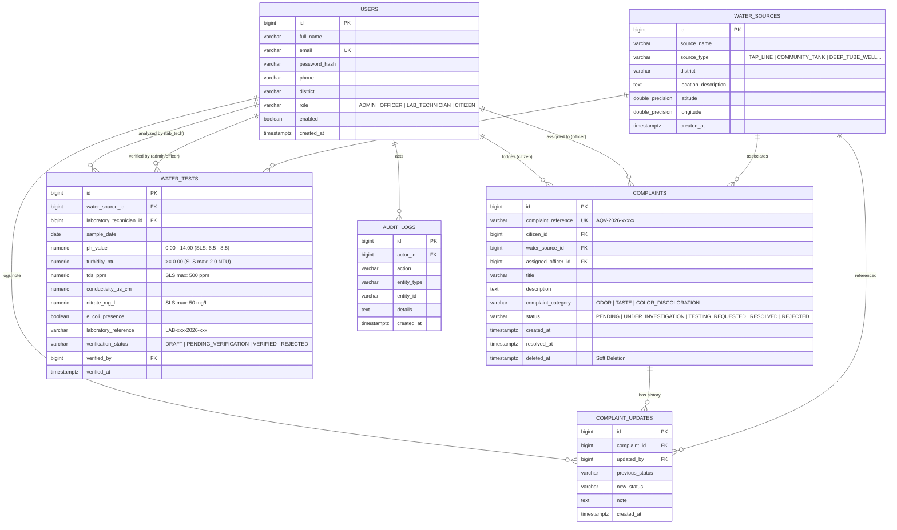

# AquaVerify LK — Drinking Water Quality Monitoring & Complaint Management System

[](https://adoptium.net/)
[](https://spring.io/projects/spring-boot)
[](https://www.postgresql.org/)
[](https://react.dev/)
[](https://tailwindcss.com/)
[](LICENSE)

A web-based national drinking water quality surveillance and complaint lifecycle management platform tailored for Sri Lanka. **AquaVerify LK** bridges citizens experiencing water discoloration, taste abnormalities, or pipeline contamination with regional municipal water quality officers, accredited laboratory technicians, and central government administrators.

> **Academic Evaluation Note (EC4307):**
> This repository represents a full-stack engineering project evaluated out of 30 marks covering:
> - **CRUD Operations (16 Marks):** Full Create, Read, Update, Delete across Complaints, Water Sources, Laboratory Test Records, and User Management.
> - **Database Design & Normalization (4 Marks):** Relational PostgreSQL 18 schema with primary/foreign keys, check constraints, composite indexes, soft-deletion, and Flyway V1/V2 migrations.
> - **Validation & Error Handling (2 Marks):** Server-side `@Valid` DTO validation, Sri Lankan phone and district constraints, global exception handler, and client-side reactive feedback.
> - **UI/UX & Responsiveness (2 Marks):** Marine/teal enterprise SaaS visual identity, responsive navigation, and accessible modal dialogs.
> - **Code Quality & Architecture (2 Marks):** Clean layered architecture (Controller &rarr; Service &rarr; Repository &rarr; Entity/DTO).
> - **Documentation (2 Marks):** Complete architecture overview, ER diagrams, REST API contracts, and demonstration script.
> - **Demonstration Readiness (2 Marks):** Working 1-click demo accounts and end-to-end integration test suite.

---

## 1. System Architecture

```
                             AQUAVERIFY LK ARCHITECTURE
                             
 [ Citizens / Public ]   [ Quality Officers ]   [ Lab Technicians ]   [ Administrators ]
           │                      │                      │                     │
           └──────────────────────┼──────────────────────┴─────────────────────┘
                                  │
                                  ▼
                    ┌───────────────────────────┐
                    │  React 19 + TypeScript    │
                    │  Vite • Tailwind CSS      │
                    │  Recharts • Lucide Icons  │
                    │  Port: 5173               │
                    └─────────────┬─────────────┘
                                  │ JSON / REST (JWT Bearer Token)
                                  ▼
                    ┌───────────────────────────┐
                    │  Spring Boot 3.3.5 API    │
                    │  Java 21 • Spring Security│
                    │  Port: 8080               │
                    └─────────────┬─────────────┘
                                  │ JDBC / Hibernate ORM
                                  ▼
                    ┌───────────────────────────┐
                    │  PostgreSQL 18 Database   │
                    │  Flyway Migrations (V1,V2)│
                    │  Port: 5433 (Dedicated)   │
                    └───────────────────────────┘
```

---

## 2. Entity-Relationship (ER) Diagram



---

## 3. Academic Evaluation Quick Demonstration Credentials

Four pre-configured demonstration accounts are seeded in the database. On the **Login Page** (`/login`), click any demo button for **1-click autofill**:

| Role | Email Address | Password | Permissions & Capabilities |
| :--- | :--- | :--- | :--- |
| **Administrator** | `admin@aquaverify.lk` | `Admin@123` | Executive KPI dashboard, user provisioning, complaint assignments, water source CRUD, audit logs, and test verification. |
| **Quality Officer** | `officer@aquaverify.lk` | `Officer@123` | Assigned complaint triage, investigation notes logging, status progression, category frequency analytics. |
| **Lab Technician** | `lab@aquaverify.lk` | `Lab@123` | Chemical & physical sample entry (pH, turbidity, TDS, nitrates), SLS 614 standard compliance checks, draft test CRUD. |
| **Citizen User** | `citizen@aquaverify.lk` | `Citizen@123` | Water complaint lodging, personal complaint search/filtering, timeline tracking, edit/delete pending reports. |

---

## 4. Sri Lanka Standard Reference (SLS 614:2013)

AquaVerify LK evaluates drinking water measurements against the Sri Lanka Standard specification for potable water:

| Test Parameter | SLS 614 Acceptable Limit | Health / Engineering Significance |
| :--- | :--- | :--- |
| **Hydrogen Ion (pH)** | **6.50 – 8.50** | Values &lt; 6.5 cause copper/lead piping corrosion; values &gt; 8.5 cause scale accumulation and caustic taste. |
| **Turbidity (NTU)** | **&le; 2.00 NTU** | High turbidity shields pathogenic bacteria and protozoans from chlorine disinfection. |
| **Total Dissolved Solids** | **&le; 500 ppm** | Excessive mineral solids impart unpalatable brackish or mineral taste. |
| **Nitrate ($NO_3^-$)** | **&le; 50 mg/L** | Agricultural runoff indicator; high levels cause infant methemoglobinemia. |
| **Escherichia coli** | **0 / 100 mL (Absent)** | Definitive indicator of recent human or animal fecal contamination. |

*Disclaimer: AquaVerify LK is an academic demonstration platform and does not replace official laboratory certification by accredited institutions.*

---

## 5. Quick Start Instructions (Windows PowerShell)

### Prerequisites
- **Java 21** (`java -version`)
- **Node.js 20+** (`node -v`)
- **PostgreSQL 18** (or PostgreSQL 15+)

### 1-Click Launch All Services
From the repository root (`d:\AquaVerify LK`):
```powershell
.\scripts\start-all.ps1
```
This script automatically:
1. Verifies/starts the isolated PostgreSQL 18 cluster on port `5433`.
2. Starts the Spring Boot backend on `http://localhost:8080`.
3. Starts the Vite frontend on `http://localhost:5173`.

### Individual Service Commands

#### A. Database (Port 5433)
```powershell
.\scripts\start-db.ps1
```

#### B. Backend (Port 8080)
```powershell
cd backend
.\mvnw.cmd spring-boot:run
```

#### C. Frontend (Port 5173)
```powershell
cd frontend
npm run dev
```

---

## 6. Running the Full-Stack Test Suite

To run all automated verification tests:
```powershell
.\scripts\test-all.ps1
```

### Backend Automated Test Coverage
- `PasswordEncoderTest`: Verifies BCrypt hash generation and token secret strength.
- `AquaVerifyApplicationTests`: Spring Boot application context and PostgreSQL connection test.
- `AuthControllerTest`: 7 MockMvc security tests verifying citizen registration, duplicate email rejection, password strength checks, authentication failure responses, and `/api/auth/me` protected endpoint.
- `CrudIntegrationTest`:
  - **Citizen Flow:** Creates a complaint (`POST /api/complaints`), reads details with timeline, updates title (`PUT`), and soft-deletes (`DELETE`).
  - **Officer Flow:** Progression to `UNDER_INVESTIGATION` and `RESOLVED` with timeline notes.
  - **Lab Technician & Admin Flow:** Creates test record, verifies SLS 614 calculation, verifies and publishes to public feed.

### Frontend Automated Build Validation
```powershell
cd frontend
npm run build
```
Executes TypeScript typechecking (`tsc -b`) and production asset bundling (`vite build`) producing zero compilation errors.

---

## 7. REST API Reference

All protected endpoints require `Authorization: Bearer <JWT>` header.

### Authentication
- `POST /api/auth/register` — Citizen registration (strictly assigns `CITIZEN` role).
- `POST /api/auth/login` — Authenticates user, returns JWT and user profile.
- `GET /api/auth/me` — Retrieves authenticated user profile.
- `POST /api/auth/forgot-password` — Requests password reset token.
- `POST /api/auth/reset-password` — Sets new password via token.
- `POST /api/auth/logout` — Terminates user session.

### Complaints (Complete CRUD)
- `POST /api/complaints` — Submit water complaint (generates reference code `AQV-2026-xxxxx`).
- `GET /api/complaints` — Search, filter by status, category, district, and paginate complaints.
- `GET /api/complaints/{id}` — Get complaint details, assigned officer, timeline updates, and related tests.
- `PUT /api/complaints/{id}` — Update complaint details (permitted only when status is `PENDING`).
- `PATCH /api/complaints/{id}/status` — Update investigation status and log inspection note (`OFFICER` / `ADMIN`).
- `PATCH /api/complaints/{id}/assign` — Assign complaint to district quality officer (`ADMIN`).
- `DELETE /api/complaints/{id}` — Soft-delete pending complaint (`CITIZEN` / `ADMIN`).

### Water Sources (Complete CRUD)
- `POST /api/water-sources` — Register new drinking water source (`ADMIN`).
- `GET /api/water-sources` — List water sources with pagination, district, and type filtering.
- `GET /api/water-sources/all` — Unpaginated source list for dropdown selectors.
- `GET /api/water-sources/districts` — Distinct monitored districts.
- `GET /api/water-sources/{id}` — Single source details with active complaint count.
- `PUT /api/water-sources/{id}` — Update source coordinates or description (`ADMIN`).
- `DELETE /api/water-sources/{id}` — Delete water source (`ADMIN`).

### Water Tests (Complete CRUD & SLS 614 Verification)
- `POST /api/water-tests` — Record physical & chemical water test (`LAB_TECHNICIAN` / `ADMIN`).
- `GET /api/water-tests` — List water tests with pagination and verification status filter.
- `GET /api/water-tests/verified` — Public transparency feed of SLS 614 verified test records.
- `GET /api/water-tests/{id}` — View analytical certificate.
- `PUT /api/water-tests/{id}` — Update draft test measurements.
- `PATCH /api/water-tests/{id}/verify` — Mark test `VERIFIED` or `REJECTED` for public release (`ADMIN` / `OFFICER`).
- `DELETE /api/water-tests/{id}` — Delete draft test record (`LAB_TECHNICIAN` / `ADMIN`).

### Dashboard & Analytics Telemetry
- `GET /api/dashboard/public-stats` — Live database counts for public landing page.
- `GET /api/dashboard/citizen` — Citizen complaint metrics and nearby verified tests.
- `GET /api/dashboard/officer` — Officer assigned cases and category frequency chart data.
- `GET /api/dashboard/laboratory` — Laboratory sample metrics and test trends.
- `GET /api/dashboard/admin` — Executive system KPIs, district frequency chart, and audit logs.

### User Management
- `GET /api/users` — Paginated user directory with role and district filtering (`ADMIN`).
- `POST /api/users/staff` — Provision Quality Officer or Lab Technician accounts (`ADMIN`).
- `PUT /api/users/{id}` — Update account information.
- `PATCH /api/users/{id}/status` — Enable or disable account access (`ADMIN`).

---

## 8. Academic Demonstration Walkthrough (5-Minute Script)

1. **Public Landing Page (`/`):**
   - Showcase the **AquaVerify LK Logo** with water droplet, trust shield, and wave motif.
   - Point out the **Live Database Telemetry** counter displaying real values queried directly from PostgreSQL.
   - Scroll to **Verified Water Quality Reports** and demonstrate filtering by Sri Lankan district.
2. **Citizen Registration & Login:**
   - Click **Sign In**, then click the **Citizen User** button for 1-click autofill (`citizen@aquaverify.lk` / `Citizen@123`).
   - Arrive at the **Citizen Portal** (`/dashboard/citizen`).
   - Click **Submit Water Complaint**, fill in title (*"Discoloration and iron smell in tap water"*), category (*COLOR_DISCOLORATION*), and submit.
   - Observe the newly generated tracking code (e.g. `AQV-2026-xxxxx`) appear with status `Pending Review`.
   - Click the eye icon to inspect the **Investigation Timeline** initialized with the creation log.
3. **Officer Investigation:**
   - Log out and log in with **Quality Officer** (`officer@aquaverify.lk` / `Officer@123`).
   - Observe the **Assigned Cases** table and the **Recharts Bar Chart** showing real category frequencies.
   - Click **Update Status** on the complaint, select `UNDER_INVESTIGATION`, enter field inspection findings, and save.
   - Note that the status badge updates and the note is persisted to the audit timeline.
4. **Laboratory Sampling:**
   - Log in as **Lab Technician** (`lab@aquaverify.lk` / `Lab@123`).
   - Click **Add Water Sample Test**, enter pH (`7.20`) and Turbidity (`1.45 NTU`), and submit.
   - Notice the automated SLS 614 standard evaluation tag: `Compliant`.
5. **Executive Governance:**
   - Log in as **Administrator** (`admin@aquaverify.lk` / `Admin@123`).
   - Review executive KPIs and the **District Incident Distribution Chart**.
   - Navigate to **User Management** and demonstrate **Provision Staff Account** to show officer/lab technician creation.
   - Navigate to **Lab Test Verifications** and click **Verify & Publish** to release the test to the public transparency feed.

---

## 9. License

Developed for academic evaluation under course module **EC4307**. All rights reserved.
